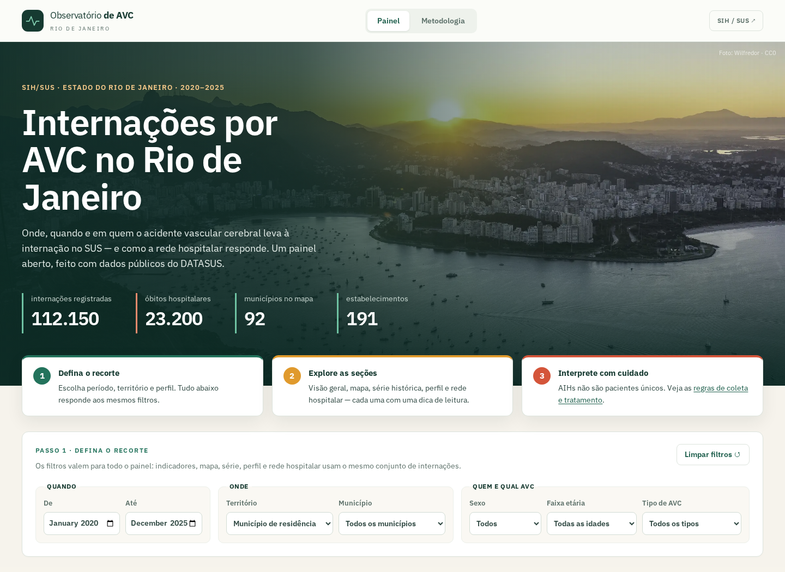

# Observatório de AVC

Pipeline de dados públicos com Python e SQL, painel interativo e relatório reproduzível sobre internações por AVC no Rio de Janeiro.

Desenvolvido por [Moscarde](https://github.com/moscarde).

**Versão online:** [avc.riocode.com.br](https://avc.riocode.com.br/).



## Da fonte ao produto

```text
DATASUS → ETL Python → agregados e proveniência → painel React
                               ↓
                  validação offline → Parquet → DuckDB/SQL → relatório HTML
```

O projeto demonstra seleção e tratamento de registros SIH-RD, deduplicação, contratos, hashes, auditorias, modelagem SQL, filtros consistentes e recuperação de publicações. A análise roda localmente, sem serviços pagos ou banco permanente.

Os dados existentes cobrem **72 competências de 2020–2025**, com **112.150 internações** e **23.200 óbitos hospitalares**. Nesta evolução, os agregados foram reutilizados e reconciliados; não houve nova coleta. Os brutos da extração histórica não estão nesta cópia.

## Gerar a análise

Requisitos: Python 3.12+. A instalação das dependências requer rede; os comandos analíticos usam os dados já incluídos.

```bash
python3 -m venv .venv
source .venv/bin/activate
pip install --require-hashes -r requirements-dev.txt
python -m etl.validate
python -m etl.analytics
```

Abra `reports/index.html`. O relatório é um arquivo independente, com CSS, gráfico SVG e tabelas incorporados. Cada execução preserva Parquets, banco DuckDB, resultados SQL, reconciliação e hashes em `reports/runs/<id>/`.

```bash
# Recorte aplicado a todos os indicadores e tabelas
python -m etl.analytics --sex Feminino --cid I63 --residence 330455 --start-period 2024-01
```

Veja a [análise territorial no painel](docs/images/painel-analise.png), o [relatório em desktop](docs/images/relatorio-desktop.png) e [celular](docs/images/relatorio-mobile.png).

## Executar o painel

Requisito: Node.js 22.18+ (`.nvmrc`: Node 22).

```bash
cd frontend
npm ci
npm run dev
```

Abra `http://127.0.0.1:5180`. Para produção, `npm run build` gera `frontend/dist/`. O painel consome os agregados versionados, sem API ou Python em produção.

## Qualidade e reprodução

```bash
python -m unittest discover -s tests -v
ruff check etl tests
ruff format --check etl tests
cd frontend
npm run lint
npm test
npm run build
```

`npm test` precisa do ambiente Python acima e reconcilia SQL e TypeScript em três recortes reais. Os dois testes específicos de PySUS são ignorados se o extra não estiver instalado; para executá-los, use `requirements-extract.txt` em vez de `requirements-dev.txt`.

Testes de navegador: `npx playwright install chromium` e `npm run test:e2e`. O workflow em `.github/workflows/ci.yml` repete os checks sem coletar dados. Confira as [evidências locais e limites](docs/validacao.md); não há execução remota de CI declarada.

## Documentação

- [Arquitetura e decisões](docs/arquitetura.md)
- [Modelo, grão e indicadores](docs/modelo-de-dados.md)
- [Metodologia, fontes e limites](docs/metodologia.md)
- [Execução offline e recuperação](docs/operacao.md)
- [Entregas e próximos passos](docs/planejamento.md)
- [Contribuição](CONTRIBUTING.md) e [histórico](CHANGELOG.md)

`etl/` contém a implementação Python; `contracts/`, o contrato público; `sql/`, os modelos analíticos; `templates/`, o relatório; `frontend/`, o painel. Dados intermediários e relatórios gerados ficam fora do Git.

## Interpretação e licença

Fonte: SIH/SUS — DATASUS, arquivos RJ, por competência de processamento. Inclui AIHs normais (`IDENT=1`), diagnóstico principal I60–I64 e I62 identificável; exclui G45, I69 e prorrogações. AIHs não são pacientes únicos. Mortalidade é hospitalar; valores de AIH não representam custo econômico integral. Residência e internação são dimensões distintas.

Código próprio sob [MIT](LICENSE). Fontes de dados e ativos mantêm suas condições e atribuições, descritas em [créditos de terceiros](THIRD_PARTY_NOTICES.md).
